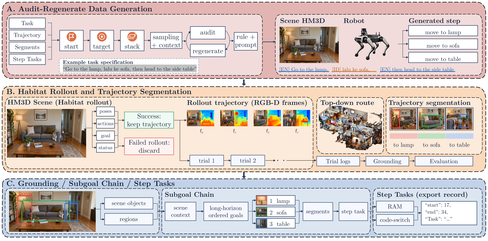

# IDEN-VLN

**An Indonesian-English Code-Mixed Dataset for Long-Horizon Vision-and-Language Navigation**

IDEN-VLN contains **2,500 tasks, 3,291 step-task segments, and 155 scenes**, with random and scene-held-out splits. It combines operational Indonesian-English instructions with ordered object/room metadata and simulator-backed navigation diagnostics.

This repository accompanies the current research manuscript. It contains the compact dataset, selected experiment sources and summaries, and the attributed LH-VLN/NavGen generation adaptation. Publication venue and DOI are not asserted here.

[Dataset](#dataset) · [Quickstart](#quickstart) · [Documentation](docs/README.md) · [Results](#navigation-results-and-interpretation) · [Citation](CITATION.md)

## Navigation demo

https://github.com/user-attachments/assets/7790a556-8685-494a-bb3e-638c4ad7c81d

**Level 3 · 44.4 seconds · 1080p · LM Roman 10.** A selected three-stage simulator demonstration with the original Indonesian–English instruction. Stage names: armchair, TV, bed. This is a **teacher/oracle replay**, not a learned-policy generalization result. It shows navigation only; pickup and placement are not simulated. Completion follows the historical distance scorer and does not establish human-validated target visibility.

[Download MP4](assets/iden-vln-level3.mp4) · [Video source and checks](docs/NAVIGATION_DEMO.md)

## Dataset

Files are available directly in [dataset/](dataset/):

- [High-level tasks](dataset/iden_vln_tasks.jsonl): 2,500 records.
- [Step-task segments](dataset/iden_vln_step_tasks.jsonl): 3,291 records.
- [Random split](dataset/splits_random.json) and [scene-held-out split](dataset/splits_scene_heldout.json).
- [Data card](dataset/DATA_CARD.md), [source export manifest](dataset/release_manifest.json), and [package checksums](dataset/release_checksums.json).

The compact release excludes raw RGB-D trajectories, HM3D meshes, semantic assets, NavMeshes, and model weights. External assets remain subject to their providers' access conditions. Original project code contributions have a scoped MIT grant. Dataset CC BY licensing is deferred because HM3D-derived rights require review; unrestricted commercial dataset use is not asserted. See [license scope](LICENSE), [dataset reuse notice](dataset/LICENSE.md), and [notices](NOTICE.md).

## Quickstart

Python 3.9+; no third-party packages or GPU required:

```bash
git clone https://github.com/aimldlnlp/iden-vln.git
cd iden-vln
python tools/verify_release.py
```

The check validates checksums, unique identifiers, segment-parent mappings, split coverage, split labels, and scene disjointness for the scene-held-out split.

### Read your first task

No simulator, API key, model download, or third-party package is needed for this example:

```python
import json
from pathlib import Path

root = Path("dataset")
with (root / "iden_vln_tasks.jsonl").open(encoding="utf-8") as records:
    task = json.loads(next(records))

print(task["task_id"], task["level"], task["robot"])
print(task["task_instruction"])

split = json.loads((root / "splits_scene_heldout.json").read_text(encoding="utf-8"))
print({name: split[name]["count"] for name in ("train", "val", "test")})
```

Scene-held-out task counts are **2,019 / 247 / 234** across train/val/test, with no scene overlap. Random task counts are **2,000 / 250 / 250**, with scene overlap. Segment records inherit their parent's split; see the [schema and split rules](dataset/DATA_CARD.md).

### Choose your next step

| Goal | Entry point |
|---|---|
| Inspect task/segment fields and limitations | [Release data card](dataset/DATA_CARD.md) |
| Train textual grounding | [Textual grounding](#textual-grounding) |
| Reconstruct navigation experiments | [Reproducibility status](docs/REPRODUCIBILITY.md) |
| Generate new instructions and rollouts | [Generation guide](docs/generation.md) |
| Find results, source variants, and help | [Documentation guide](docs/README.md) |


## Repository guide

- `dataset/`: portable task records, split assignments, schema, checksums.
- `research/grounding/`: XLM-R grounding training with dataset/output CLI paths.
- `research/navigation/`: selected navigation, goal construction, audit, and IL sources plus their static local import dependencies.
- `research/legacy/`: earlier grounding and policy experiment sources used by later scripts.
- `research/snapshots/`: preserved per-run repair, recovery, and STOP-counter sources.
- `research/source_variants/`: server versions retained where local and server sources differ.
- `research/data/`: source exporter and server generation batch driver.
- `results/`: selected frozen protocols, metric summaries, and verification records.
- `results/manuscript_tables/`: numerical table sources from the current manuscript.
- `docs/`: reproduction boundaries, provenance, and paper-to-code mapping.

**Research snapshots are not a turnkey simulator installation.** Many retain historical absolute paths and need external source records, checkpoints, model assets, and exact run layouts. Copying this folder alone does not reconstruct the original training environment. See [reproducibility](docs/REPRODUCIBILITY.md) before running them.

## Textual grounding

Install PyTorch appropriate for your platform, then the analysis dependencies:

```bash
python -m pip install -r requirements-analysis.txt
python research/grounding/train_xlmr_grounding.py --help
python research/grounding/train_xlmr_grounding.py --data-root dataset --run-root outputs/xlmr --split scene_heldout --seed 20260801
```

The default encoder is `xlm-roberta-base`; pretrained weights are obtained separately. Training can be expensive. This example is an entry point, not a claim that training was rerun during repository packaging. A new seed/run is not automatically identical to the manuscript's multi-run results.

Rule/LLM extraction and TF-IDF Logistic Regression/SVM sources are under `research/legacy/`. Their historical run paths require adaptation. Aggregate XLM-R and selected grounding diagnostics are in [results/grounding/](results/grounding/).

## Navigation results and interpretation

The canonical historical evaluation underlying Table 4 uses **100 two-stage episodes per configuration, horizon 150, AABB-based goals, and strict STOP distance <1 m**. Full-chain SR, OSR, and SPL are zero in that historical cohort. ISR, local CSR, CGT, and NE describe additional behavior; their definitions and denominators must remain attached to each experiment.

A **separate Balanced100 evaluation** uses 25 tasks per level 2-5, 350 stages, and ten configurations. Random obtains ISR macro **3.68%** (pooled ISR **3.14%**); the best learned ISR macro is **2.62%** for `sequence_bc_mild`. Full-chain SR is zero for all configurations. DAgger-lite OSR is **1.00%**. This is development evidence with training/exposure overlap, not an untouched held-out ranking. See [verified summaries](results/balanced100_eval_20261013_v1/verified_results.json).

Approach-goal IL, matched-contract repairs, recovery training, and STOP-counter ablations use distinct contracts. Teacher replay success is not learned-policy success. Training-set fit and text controls do not establish generalization. See the [experiment mapping](docs/PAPER_CODE_MAP.md) and [experiment recap](docs/experiment-records/experiment-results-recap-20261014.md).

## Construction pipeline



**Construction overview from the manuscript.** Stage A generates candidates with Qwen2.5 7B, an audit-regenerate loop, and rule-based extraction. Stage B retains trajectory-success episodes in Habitat/HM3D and segments their trajectories. Stage C grounds ordered subgoals and exports step-task records. Scene, robot, and RGB-depth illustrations are schematic; they are not measured simulator observations. The figure does not quantify generation success or demonstrate learned-policy success. See [pipeline-to-code mapping](docs/PAPER_CODE_MAP.md).

## Generation, attribution, and citation

The root generation pipeline adapts [HCPLab-SYSU/LH-VLN](https://github.com/HCPLab-SYSU/LH-VLN), including NavGen. Qwen-compatible helpers, Indonesian-English prompts, and language metrics form the generation adaptation. Additional project experiment implementations are documented in [provenance](docs/PROVENANCE.md). Existing third-party code is not relabeled as independently authored.

See [generation instructions](docs/generation.md), [citation](CITATION.md), and [notices](NOTICE.md). The inherited root `requirements.txt` is a historical generator dependency list; it is not the tested environment for every later experiment.

## Help and citation

For questions and reproducibility reports, use [GitHub Issues](https://github.com/aimldlnlp/iden-vln/issues). Include the commit, task ID, environment, and minimal command. Do not attach credentials or restricted scene assets.

Use GitHub's **Cite this repository** action, powered by [CITATION.cff](CITATION.cff). The [citation guide](CITATION.md) includes both IDEN-VLN and the upstream LH-VLN/NavGen work. Citation metadata describes the repository, not an accepted paper.

## Licensing

[MIT](LICENSES/MIT.txt) covers the owner-controlled original code contributions listed in [LICENSE](LICENSE). It does not relicense third-party code, source-derived records/media, experiment data, or model weights. Read the [per-component scope](docs/LICENSE_SCOPE.md) and [dataset notice](dataset/LICENSE.md). For the compact dataset, limited owner-controlled permission supports non-commercial academic research under [project terms](dataset/TERMS_OF_USE.md) and a [private, recorded acceptance process](docs/DATA_ACCESS.md); provider conditions remain in force. No blanket Creative Commons license or public access service is claimed.
