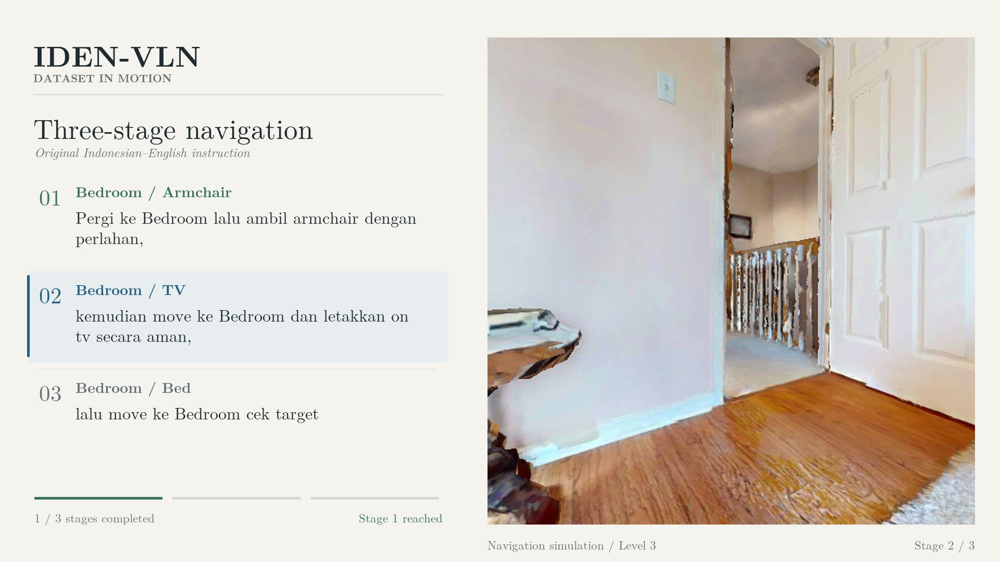

# Navigation demonstration

[Download the MP4](../assets/iden-vln-level3.mp4). The repository README also contains the [GitHub attachment player](https://github.com/user-attachments/assets/7790a556-8685-494a-bb3e-638c4ad7c81d). The completed [media record](https://github.com/aimldlnlp/iden-vln/issues/1) retains its original caption. Access follows the repository's visibility and membership rules.

## Original instruction

> Pergi ke Bedroom lalu ambil armchair dengan perlahan, kemudian move ke Bedroom dan letakkan on tv secara aman, lalu move ke Bedroom cek target

The video presents this original instruction without rewriting it. The three target labels come from the same task metadata: armchair, tv, bed. The third clause is generic in the original record; the bed annotation is shown separately rather than inserted into the instruction.

## What the clip establishes

This is a selected successful **teacher/oracle demonstration** from the development bank, not a learned-policy test result. The task ID is `old_128f8e49ee9cadc2`; see the machine-readable provenance for the scene, robot and stage records.

All 38 archived actions are replayed with the original start pose through the actual simulator actor. The historical scorer uses index-aware snapped AABB targets, strict geodesic distance below 1 m, and horizon 150. Three STOP distances are approximately 0.781934 m, 0.666246 m, and 0.620094 m. Maximum position replay error is 0 m. All three goals begin beyond the success radius at activation.

Distance-based completion does not establish that every object is visible or centered, that every room annotation has been manually confirmed, or that the policy generalizes. Picking up an armchair and placing it on a television are not physically simulated. The clip is a navigation projection of the task wording. Historical Table 4 and Balanced100 learned-policy scores remain unchanged.

## Presentation and verification

- H.264 MP4, yuv420p, 1920×1080, 30 fps, 44.4 seconds.
- 3,389,508 bytes; SHA256 `c00918afba53b2f104501c0111bdab91b35b3703cedd92db6cd9e36ed32a039f`.
- Every video text element uses LM Roman 10 regular, bold or italic. English interface labels surround the original code-mixed instruction.
- Full 512×512 simulator observations are retained and upscaled, without cropping or invented camera movement. A 1080p container does not imply native 1080p sensor detail.
- All archived actions remain in sequence; repeated frames control timing and pause at verified STOPs.
- Full-file decode, output hash, replay positions and the three STOP events were checked. The encoded layout was visually compared with the supplied previous design.

Machine-readable evidence is in [navigation-demo-provenance.json](../assets/navigation-demo-provenance.json). HM3D/Habitat and inherited research components retain their own access and reuse conditions; see [notices](../NOTICE.md). No blanket license is granted for third-party scene content.
